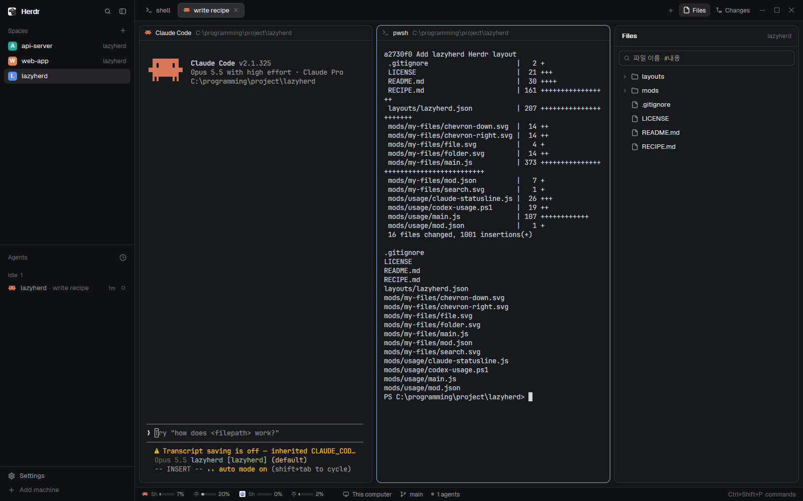

# lazyherd

A [Herdr](https://herdr.dev) layout for working with coding agents: spaces and
agents on the left, pane cards in the middle, a searchable Files / Changes
panel on the right, and Claude / Codex subscription usage in the status bar.

## Install

Ask the agent in your Herdr to add it:

> Add the Herdr layout from https://github.com/E1psycongr00/lazyherd

Or by hand: copy `layouts/lazyherd.json` into `~/.config/herdr-app/layouts/`
and `mods/my-files/`, `mods/usage/` into `~/.config/herdr-app/mods/`, add the
`layout:lazyherd` section of `keys.json` to `~/.config/herdr-app/keys.json`,
then switch to it in Settings or with `herdr-app do layout.switch --name lazyherd`.

## Keys

- `Ctrl+Shift+Y` opens or closes the right panel (Files or Changes, whichever
  was shown last); the tab bar buttons do the same.
- `Alt+L` from the rightmost pane moves into Files. In the tree, ↑ / ↓ move,
  → / ← open and close folders, Enter previews a file, `/` or ↑ on the first
  row goes to the search box, and Escape goes back to the terminal.

- File content search (`#text`) needs [ripgrep](https://github.com/BurntSushi/ripgrep).
- Claude usage needs the bundled Claude Code status line
  (`mods/usage/claude-statusline.js`); Codex usage currently works on Windows.
  See [RECIPE.md](RECIPE.md#watch-out).
- The UI text is in Korean.

[RECIPE.md](RECIPE.md) describes the whole layout, so an agent can rebuild or
adapt it from scratch.

## License

MIT
