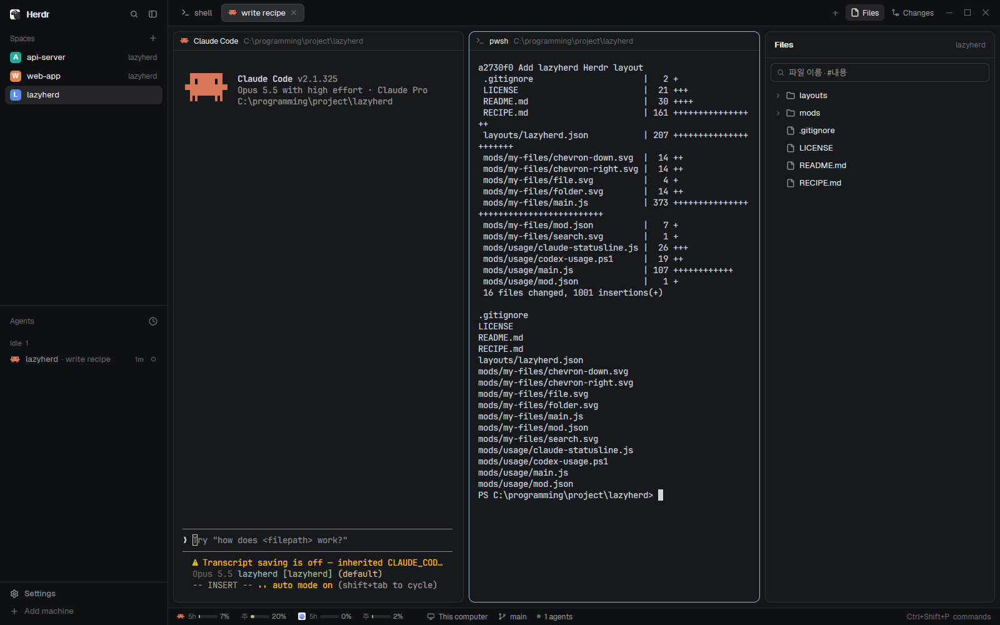

# lazyherd

Herdr's `main` layout, tuned for working with coding agents all day: a
sidebar of spaces and agents on the left, the active tab's panes in rounded
cards in the middle, and a Files / Changes panel on the right whose file tree
can be searched by name or by content (`#text`, via ripgrep). The status bar
shows how much of your Claude and Codex subscription limits (5-hour and weekly)
you've used, with a hover card that tells you when each window resets.

## What you see

Left to right, top to bottom. Colors are theme tokens, so it follows any theme.

- **Sidebar**, 268px wide (resizable by command between 44 and 480,
  `chrome` background, not drag-resizable):
  - Brand row, 46px, draggable window area: Herdr logo + "Herdr", a search
    button (opens the `picker`) and a sidebar toggle (shipped
    `workspace-chrome`).
  - Spaces list and Agents list, equal halves, each at least 90px tall
    (shipped `spaces`, `agents`).
  - Footer, 69px: "Settings" and "Add machine" rows
    (`workspace-chrome` with `props: { footer: true }`).
- **Work column**:
  - Tab bar, 42px, draggable window area, with the window buttons on Windows
    and Linux (shipped `tabs`; it also owns the Files / Changes toggles at the
    right end).
  - Body, 8px padding and 8px gaps:
    - **Main**: the active tab's panes. Each pane is a card with a 10px
      radius, 1px `border` outline (1px `accent` when focused), 8px gaps
      between cards, and an always-visible 30px header on top (shipped `pane`:
      program icon, name, folder, split / zoom / close buttons). A lone pane is
      still drawn as a card.
    - **Side panel**, 368px (280–900), hidden until opened from the tab bar.
      A stack of two blocks: **Files** (`my-files`) and **Changes** (shipped
      `changes`). Files is active by default.
  - **Status row**, 28px, not resizable:
    - **Usage** (`usage`), 400px: one group per tool, Claude then Codex. Each
      group is a 22px pill: the tool's icon (12px), then for each window a
      dim label (`5h` / `주`), a 30×5px bar and the percentage.
    - **Status** (shipped `workspace-status`), the rest: machine
      ("This computer"), git branch, agent count, "· N needs you" when agents
      are blocked, and the command-palette hint at the right end.
- Root: `canvas` background, 1px `border` dividers, terminal padding 14×12,
  no system title bar (the layout draws its own; macOS traffic lights at
  12,16).

### Files panel (`my-files`)

- 42px header: "Files" (semibold) and, right-aligned in 12px `dim`, the
  folder name, or the open file's path (`path:line` when opened from a
  content match). A `←` appears while a file is open.
- Below it a 30px search box (8px margin, 7px radius, `input` border that
  turns `accent` while searching). Placeholder: `파일 이름 · #내용`
  ("file name · #content").
- The tree of the focused pane's folder: folders first, then files, sorted
  by name; chevrons for folders; `.git` hidden. Git status marks on the
  right: `A` (added/untracked) in `ansi2` green, `D` / `U` (deleted /
  conflict) in `ansi1` red, `M` in `blocked`.
- Clicking a file shows it in a read-only, syntax-highlighted editor
  (12px, the terminal font).

## How it behaves

- **Agent statuses** come from the shipped mods: the Agents list and tab bar
  show working (spinner), blocked, done and idle; the status row adds
  "· N needs you" in `blocked` color while any agent is blocked.
- **Sidebar**: the toggle (or `ctrl-shift-b`) folds it to a 44px rail (76px
  on macOS) and back to the width it had.
- **Side panel**: the Files / Changes buttons in the tab bar open it on that
  block; it is remembered per space. `ctrl-shift-y` (`keys.json`,
  `layout:lazyherd` section) opens or closes it on the block shown last.
- **Files follows focus**: it always shows the focused pane's folder (also
  on remote machines). It refreshes every 10 s and whenever the local folder
  changes, and remembers which folders were open and which file was shown
  per folder.
- **Search by name**: typing lists every file under the folder (git repos:
  tracked + untracked, minus ignored; elsewhere a walk that skips `.git` and
  `node_modules`). All space-separated words must appear; names that start
  with the first word rank first. Up to 200 results, 30px rows with the name
  and its folder in `dim`.
- **Search by content**: a query starting with `#` runs ripgrep 300 ms after
  typing stops: literal text, smart case, hidden files, `.gitignore`
  respected, ≤10 matches per file, files ≤1 MB. Rows are 44px:
  `name:line`, folder, and the matching line in the terminal font.
- **Keys in the search box**: ↑ / ↓ move the selection, Enter opens it,
  Escape clears the search; with an empty box, Escape or ↓ moves into the tree.
- **Keyboard focus**: `mod.json` sets `"focusable": true`, so `pane.go`
  (Alt+L from the rightmost pane) moves onto Files while it is shown. The
  `"focus"` command from `nextCommand()` lands on the tree (the search box
  while a search is open, the preview while one is open); Alt+H goes back.
- **Keys in the tree**: a cursor row (`selected` background, also set by
  clicks). ↑ / ↓ (j / k) move (↑ on the first row goes to the search box), Home / End jump, → (l) opens a folder or steps
  into it, ← (h) closes it or steps to the parent, Enter / Space opens a
  folder or previews a file, `/` goes to the search box, Escape goes back to
  the terminals. Escape in a preview returns to the tree on that file.
- **Right-click** any tree row, search result or the header path: copies the
  full path (backslashes on local Windows, quoted when it has spaces) and
  shows a "경로 복사됨" (path copied) toast. Paste it to an agent.
- **Usage pills**: refreshed right after each request: the mod watches
  `~/.claude` (reacting only to `usage-limits.json`) and `~/.codex/sessions`,
  at most every 0.5 s for Claude and 3 s for Codex. A 60 s timer redraws reset
  times and polls instead when a folder can't be watched. Percent color: `ansi2` green below
  60%, `ansi3` yellow from 60%, `ansi1` red from 85%. A window whose reset
  time has passed shows 0%. A tool with no data is simply not shown.
- **Usage hover card** (after 250 ms, anchored bottom-left, 280px,
  `surface`, 10px radius, shadow): the tool name and "N분 전 갱신" (updated N
  minutes ago); per window its long name (`5시간` / `주간`), a 170×7px bar,
  the percentage, and "초기화 2시간 13분 후 · 14:30" (resets in … · at …).
  Codex shows a "크레딧" (credits) row when there is a balance.

## Built from

- `layouts/lazyherd.json`: a clone of the shipped `main` (0.1.15) with two
  changes: the `files` block uses `my-files` instead of `files`, and the
  28px `status` block became a `status-row` row of `usage` (400px) +
  `workspace-status` (weight 1).
- Shipped mods used as they are: `workspace-chrome`, `spaces`, `agents`,
  `tabs`, `pane`, `changes`, `workspace-status`.
- `mods/my-files/`: a clone of the shipped `files` mod (0.1.15) plus search
  and copy-path. Uses `spaces`, `panes`, `focused`, `exec`, `readTextFile`,
  `watchFolder`, `notify`; `Editor`, `Input`, `ScrollHandle` from gpui-base.
  Runs `git` (ls-files, status, rev-parse), `rg` and, to list folders, `sh`
  (macOS, Linux, remote) or, on Windows, `cmd`'s `dir` (~0.1 s; PowerShell
  takes ~0.5 s to start). The `cmd` script is fixed text run in the folder,
  with an inner `cmd` after `chcp 65001` so names come out as UTF-8; a folder
  holding links or reparse points, or output that isn't UTF-8, falls back to
  `powershell`. Closing a folder keeps its listing, so reopening shows it at
  once and lists again. Reads only inside the focused folder.
- `mods/usage/`: reads `~/.claude/usage-limits.json` with `readTextFile` and
  runs `codex-usage.ps1` with `exec("powershell", …)`; `watchFolder` tells it
  when either changed. Icons are Herdr's own
  `icons/claude.svg` and `icons/codex.svg`. No network access.
- `mods/usage/claude-statusline.js`: a Claude Code status line that, besides
  printing model / folder / project / output style, saves the `rate_limits`
  Claude Code passes it to `~/.claude/usage-limits.json` (atomically).
- `mods/usage/codex-usage.ps1`: finds the newest `rate_limits` entry in the
  given session log (`-Path`), or else in the last 5 under `~/.codex/sessions`,
  and prints it as JSON. Logs grow to tens of MB, so it reads each from the
  end (1, 8, then 64 MB) instead of the whole file.

## Watch out

- **Claude usage needs the status line.** Herdr can't see Claude Code's
  limits by itself. Copy `claude-statusline.js` to
  `~/.claude/statusline.js` and set `"statusLine": { "type": "command",
  "command": "node ~/.claude/statusline.js" }` in `~/.claude/settings.json`
  (on Windows use the full path, e.g. `node "C:/Users/<you>/.claude/statusline.js"`),
  or add its `rate_limits` block to your own status line. It fills in after Claude Code's next reply, and only for
  subscription (Pro/Max) logins.
- **Codex usage is Windows-only** as written (`powershell`). Elsewhere the
  Codex group just doesn't appear; port `codex-usage.ps1` to `sh` + `jq` (or
  call `pwsh`) to get it. It shows the limits from the last Codex session, so
  it can be stale until Codex runs again.
- **Content search needs ripgrep** on the PATH (`rg`); without it the panel
  shows how to install it.
- The UI text is Korean (labels, placeholder, toasts, reset times). Translate
  the strings in the two `main.js` files for another language.
- Opening a content match shows `path:line` in the header but does not
  scroll the preview to that line.
- Limits: 500 entries per folder and 5,000 in the tree; 50,000 files indexed
  for name search; 200 results; previews truncated at 400,000 characters.
- The mods are named `my-files` and `usage`; if those names are taken in
  your home, rename the folder, the `mods/<name>/` paths inside `main.js`,
  and the `mod` names in `layouts/lazyherd.json`.

## Done when

- `herdr-app check mods/my-files` and `herdr-app check mods/usage` pass.
- `herdr-app do layout.switch --name lazyherd` shows the sidebar, tab bar,
  pane cards and the two-part status row, and `herdr-app status` lists no
  errors.
- Opening Files from the tab bar shows the focused pane's folder with git
  marks; typing part of a file name lists it, `#` + a word in a file lists
  `name:line` matches, and Enter opens the selected one.
- Right-clicking a file puts its full path on the clipboard and shows the
  toast.
- `ctrl-shift-y` opens and closes the side panel; with Files shown, Alt+L
  from the rightmost pane puts a cursor row in the tree, the arrows move it
  and open folders, and Escape goes back to the terminal.
- After a Claude Code reply with the status line set up,
  `~/.claude/usage-limits.json` exists and the Claude pill shows `5h` and
  `주` percentages; hovering it shows the reset times.
